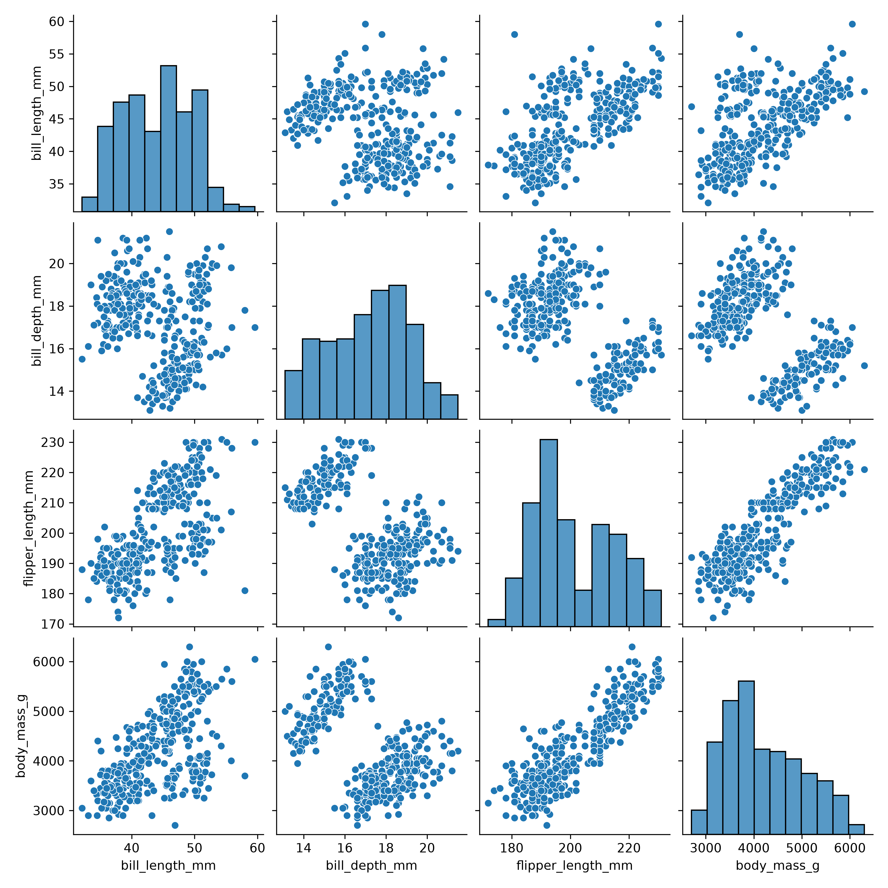
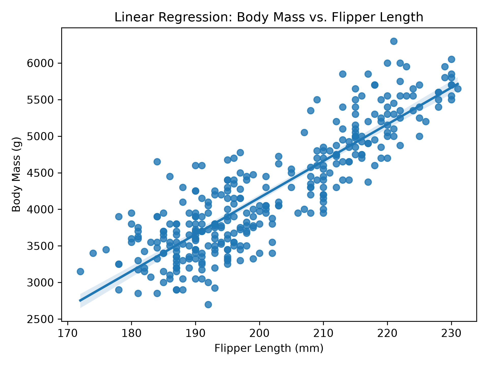
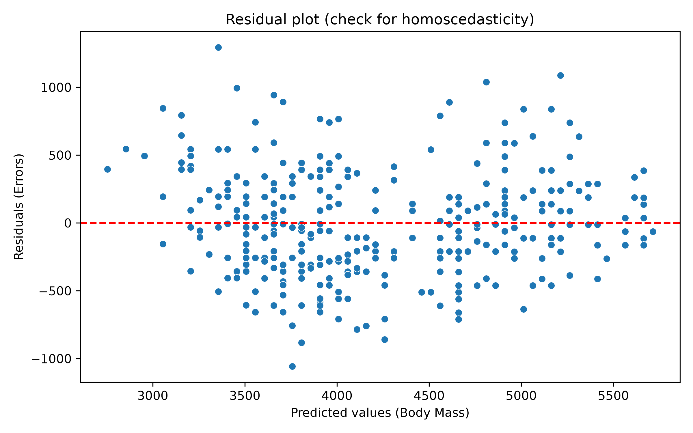
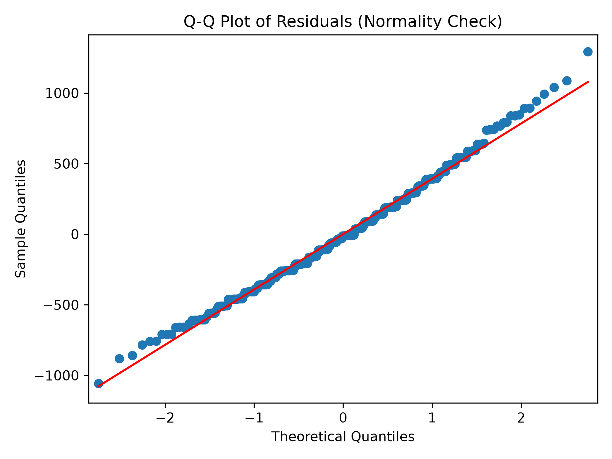

# 🐧 OLS Linear Regression: Predicting Penguin Body Mass

This project implements an **Ordinary Least Squares (OLS) Linear Regression** model using Python to analyze and predict the body mass of penguins based on their physical attributes. The primary objective is to scientifically validate whether the dataset satisfies all classical statistical assumptions for linear modeling.

## 🚀 Key Project Findings
* **Highly Powerful Predictor:** Flipper length (`flipper_length_mm`) acts as an outstanding direct predictor of body mass, explaining approximately **76.2% of the total variance in weight**.
* **Scientifically Valid Model:** This model successfully satisfies the rigorous assumptions of **Linearity**, **Normality** (evaluated via a Q-Q plot), **Homoscedasticity** (constant error variance), and **Independence** (Durbin-Watson metric close to 2.10).

## 🛠️ Technologies & Libraries Used
* **Python 3**
* **Pandas & NumPy**
* **Seaborn & Matplotlib**
* **Statsmodels & SciPy**

## 🔍 Exploratory Data Analysis (EDA)
Before training the OLS model, a matrix scatter plot (`pairplot`) was generated to visualize the general distributions and cross-variable correlations across the dataset:

<p align="center">
  
</p>

## 📈 Statistical Assumptions Framework
To ensure model robustness, the script executes a comprehensive evaluation workflow:
1. **Linearity:** Exploratory analysis using cross-variable scatter matrix visualization.
2. **Normality of Residuals:** Quantile-Quantile (Q-Q) plotting mapped against a reference line.
3. **Homoscedasticity:** Error variance monitoring through a dedicated residuals vs. fitted values scatter diagram.
4. **Independence of Observations:** Verification of zero autocorrelation among residuals by validating the Durbin-Watson statistic (2.102).

### Visual Diagnostics
Here are the plots generated by the model backing the validity of the statistical assumptions:

| 1. Model Regression Line | 2. Homoscedasticity Evaluation | 3. Normality Verification |
| :---: | :---: | :---: |
|  |  |  |

## ⚙️ How to Run the Project
1. Clone this repository:
   ```bash
   git clone https://github.com
   ```
2. Install the required dependencies:
   ```bash
   pip install statsmodels pandas numpy matplotlib seaborn scipy
   ```
3. Run the main analysis script:
   ```bash
   python penguins.py
   ```

---
*Project developed as part of a practical Data Science and Statistical Modeling case study.*


